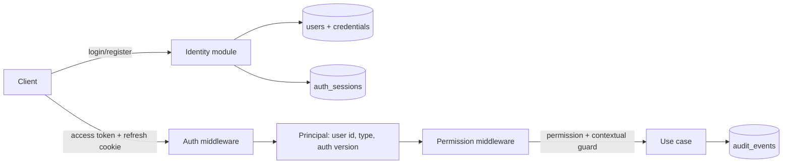
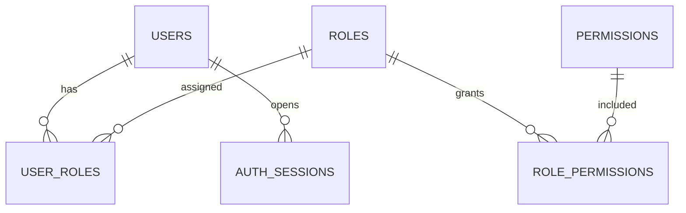

# Authentication and dynamic RBAC

## Model and authorization flow

Access token claims contain subject, principal type, session ID, expiry and `authorization_version`; they do **not** contain a permanent permission list. Middleware loads/caches active permissions keyed by `(user_id, authorization_version)` and verifies session/user state. Cache invalidates on RBAC mutation; session version mismatch rejects the request. This prioritizes immediate authorization changes over token-only convenience.

## RBAC ERD

## Permission convention and initial catalog

Format: lowercase `resource.action` with optional constrained action, e.g. `reservation.confirm`; never frontend page names. Required initial permissions:

`dashboard.read`, `property.read`, `room.create`, `room.update`, `room.archive`, `room.state.update`, `room_type.manage`, `media.manage`, `customer.read`, `customer.create`, `customer.update`, `customer.archive`, `employee.read`, `employee.create`, `employee.update`, `employee.deactivate`, `reservation.read`, `reservation.create`, `reservation.update`, `reservation.confirm`, `reservation.cancel`, `reservation.check_in`, `reservation.check_out`, `service.read`, `service.manage`, `invoice.read`, `invoice.issue`, `payment.record`, `payment.refund`, `report.read`, `report.export`, `hotel_settings.read`, `hotel_settings.update`, `support.read`, `support.assign`, `support.reply`, `support.close`, `user.read`, `user.manage`, `role.read`, `role.create`, `role.update`, `role.delete`, `permission.read`, `permission.manage`, `role_permission.assign`, `user_role.assign`, `audit.read`.

Customer self-service operations use authenticated ownership (`customer.profile.update_self`, `reservation.read_self`, `reservation.cancel_self`, `support.read_self`, `support.create`) granted by the customer principal baseline, not staff roles.

## Default initialization and lifecycle rules

- Seed immutable/system permissions and protected default roles: `system-administrator`, `hotel-manager`, `front-desk`, `accounting`. Mappings begin from the frontend’s four UI roles but are reviewed during launch.
- Bootstrap exactly one administrator from one-time deployment environment variables or a controlled CLI; mark it recovery protected. Remove bootstrap secret after use.
- Roles have stable UUID, unique `code`, editable display metadata, `is_system`, `is_protected`, archived timestamp. A protected role cannot be deleted, and system role permissions require `role.update_system` (not granted by default).
- Permission code is immutable after creation; metadata may change. Deleting/archiving a permission is forbidden while assigned or required by system policy; disable only after reassignment/audit.
- Assigning/revoking a role validates actor authority: caller may grant only permissions contained in their grantable set and cannot create/grant a role more privileged than them. Require a separate high-risk permission for system roles.
- Role delete is blocked if assignments exist; archive it after reassignment. Never cascade to users/history. User deletion is deactivation; user-role rows retain history/audit.
- Do not permit removal of the last active recovery administrator. All changes record before/after values, actor, request ID and reason.

## Authentication controls

- Passwords are Argon2id hashes with unique salt and calibrated parameters; verify server-side only.
- `POST /auth/login` returns short-lived access token in response and rotates refresh token in `Secure; HttpOnly; SameSite=Lax` cookie (or strict if UX permits). Store only hashed refresh-token family/session data.
- Rotation detects reuse: revoke the session family, audit, and require login. Logout revokes current/all requested sessions. Password change/reset, disable, and RBAC changes invalidate applicable sessions/versions.
- Uniform login/reset responses prevent account enumeration; rate limit by IP and normalized identifier. MFA is an advanced post-launch security enhancement; require it for protected administrator role when operationally possible.

Frontend role visibility is retained only for UX. Every API use case performs backend permission and contextual authorization.
