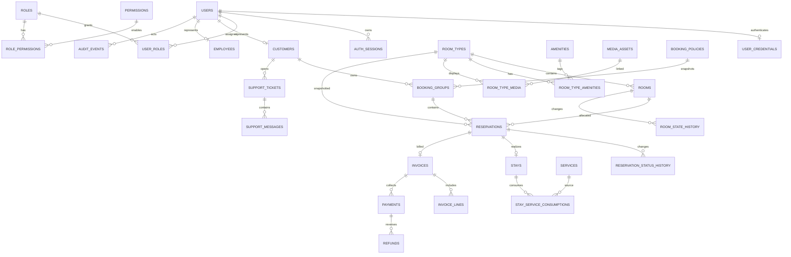
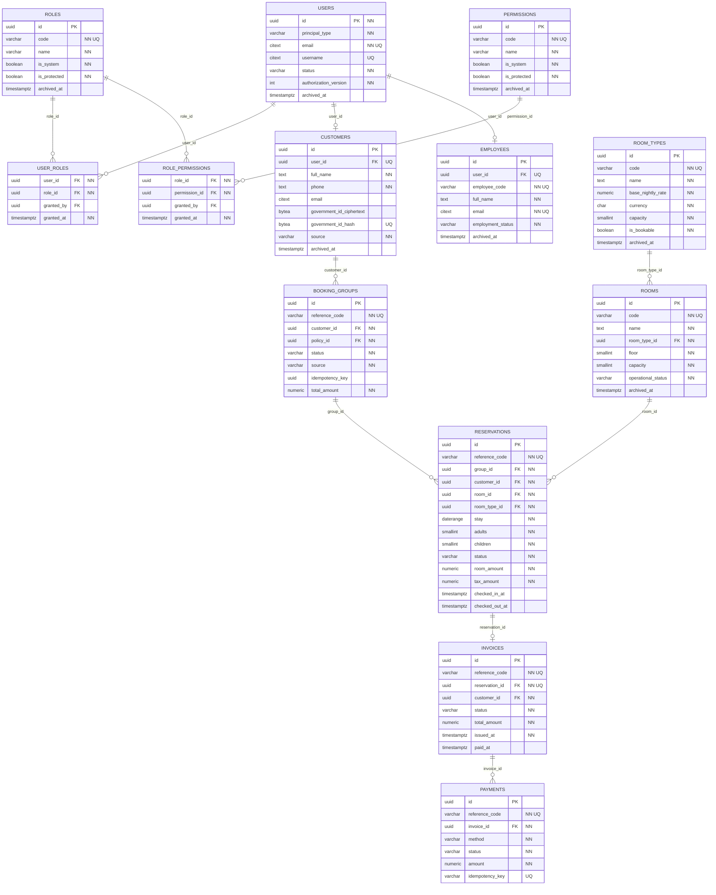

# Entity relationship diagrams

All IDs are UUID primary keys unless noted. `NN` means NOT NULL. Monetary fields are `numeric(14,2)`; timestamps are `timestamptz`.

## Overall ERD

## Core physical schema

The implementation migration contains the complete table catalogue in [database-design.md](database-design.md); Mermaid is intentionally split to remain readable.
