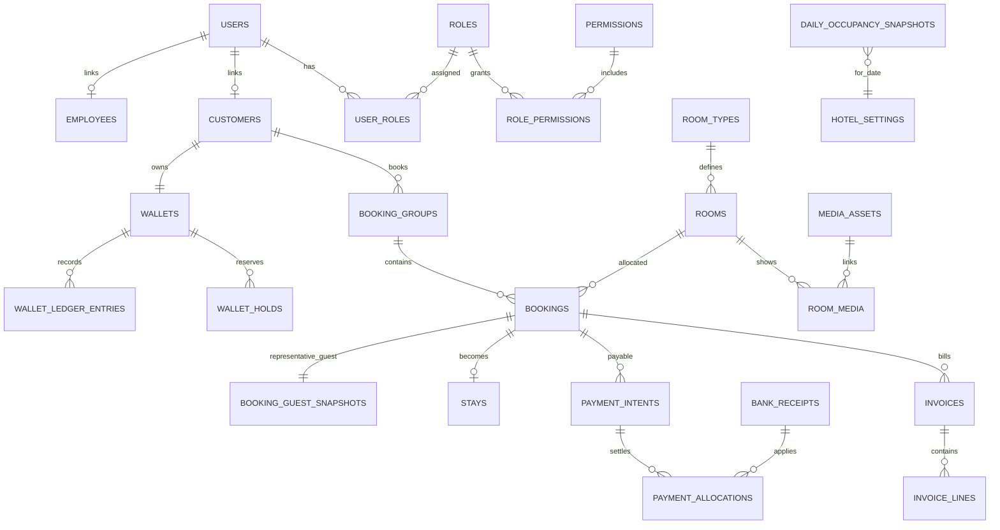
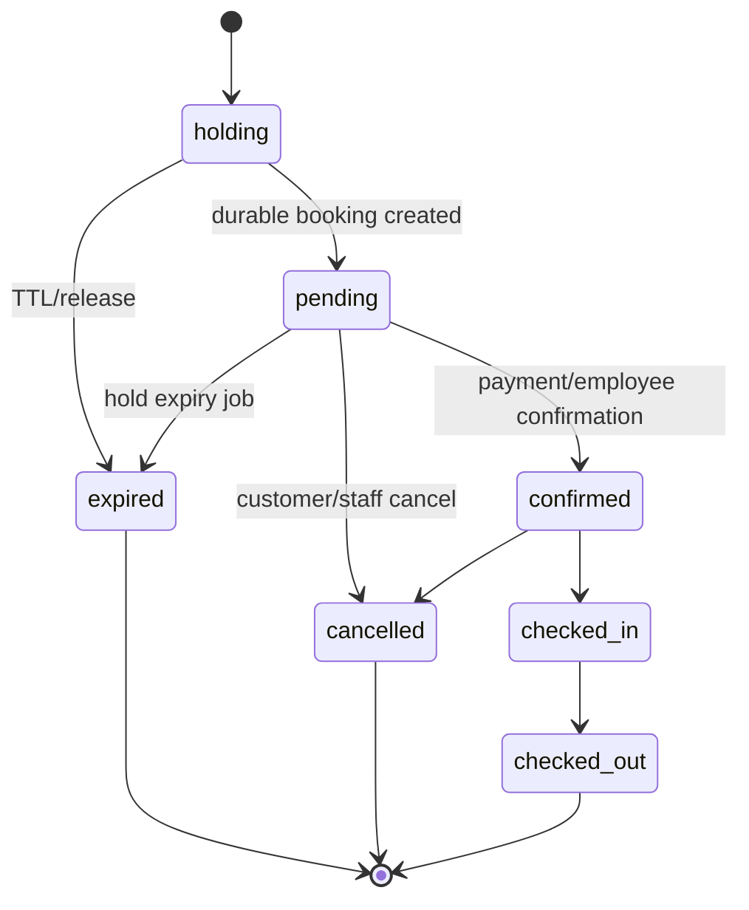
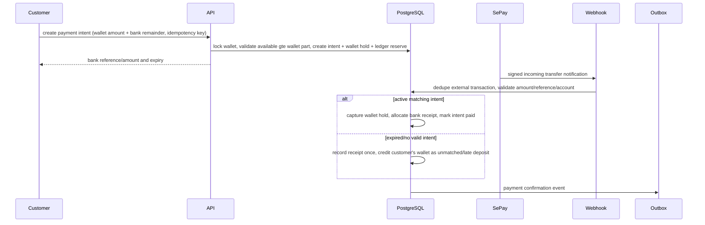

# Hotel Management System — Implementation Plan

## 1. Scope, fixed stack, and project guardrails

This is the implementation plan for a **single-hotel** graduation project. It replaces browser mock/local-storage behavior with one Go deployable, PostgreSQL as persistent source of truth, Redis for short-lived holds/cache, MinIO for room images, SePay for incoming bank-transfer notifications, SMTP for transactional email, and database-driven Dynamic RBAC. The API is REST.

The system covers customer accounts, customer/representative guest booking, temporary inventory holds, individual and group bookings, staff operations, wallet/bank-transfer payment, refunds to wallet, room media, reporting, audit, and RBAC. It does not introduce multi-tenancy, microservices, bank payouts, full guest-registration/identity-verification, online card payments, reviews, SMS, social login, or a general document-management system.

### Confirmed invariants

1. PostgreSQL is authoritative for bookings, financial balances/history, statuses, policy data, and reports; Redis is never authoritative.
2. One physical room cannot have overlapping active stays. PostgreSQL enforces this, not merely frontend/backend prechecks.
3. A pending booking is temporary and must have a Redis-backed hold expiry. Individual and group hold expiries are independent, configurable, and captured when created.
4. Group booking is a real aggregate containing individual bookings; cancelling one child does not automatically cancel siblings. Batch actions are all-or-nothing in PostgreSQL.
5. Customer (booker/payer) and representative Guest (stayer) are distinct. Guest details are immutable booking snapshots; multiple-guest support is extensible but out of demo scope.
6. Wallet balances cannot be negative. Every balance movement has an immutable ledger record; holds/reservations are distinct from captured payment.
7. Revenue is actual received money net of refunds; unpaid/pending/expired/cancelled bookings are not collected revenue.
8. Admin root privilege is immutable and automatically includes future permissions. UI authorization is never authoritative.

## 2. Repository discovery and conflicts

The repository contains a React/Vite frontend in `FrontEnd/`; `BackEnd/` has no application implementation. Existing documents are in `BackEnd/docs/`. The frontend implements customer and `/admin` surfaces but stores all mock services, local sessions, local settings, online accounts/data, support requests, and its four-role permission matrix in browser memory/storage.

| Existing artifact                                                                                     | Conflict / limitation                                                 | Resolution in this plan                                                                                             |
| ----------------------------------------------------------------------------------------------------- | --------------------------------------------------------------------- | ------------------------------------------------------------------------------------------------------------------- |
| Frontend uses one `customer` object as booking owner and guest fields separately only in booking form | requirement separates Customer and Guest                              | preserve a Customer owner plus booking-time representative guest snapshot; frontend contract changes later.         |
| Booking service creates a pending booking immediately and compensates in memory                       | no atomic Redis holds or durable concurrency control                  | introduce Hold + Booking/Group Booking state workflow; PostgreSQL exclusion constraint is final booking protection. |
| VAT/service fee/free-cancel values are frontend constants                                             | VAT must be admin-managed; other values are only examples             | VAT table/configuration; cancellation fee policy remains configurable/confirmation needed.                          |
| Invoice is created at checkout and merely toggled paid/unpaid                                         | SePay, wallet, split payment, refunds and revenue requirements absent | separate Payment Intent, payment allocations, wallet ledger, receipts and refunds.                                  |
| employee CRUD stores username but no credential activation/role                                       | requirement mandates every employee has account and email activation  | employee creation atomically creates staff user in activation-pending state.                                        |
| UI permission matrix is localStorage with hardcoded labels                                            | Dynamic RBAC/root requirements                                        | RBAC tables and server authorization; labels become seeded defaults only.                                           |
| logo is browser data URL; room images and marketing images are static/Unsplash                        | MinIO/media requirement                                               | a separate Media module owns object metadata and MinIO workflow.                                                    |
| reports are mock/random values                                                                        | reporting definitions are now fixed                                   | Reporting queries persisted financial/snapshot data only.                                                           |

## 3. Architecture and dependency direction

One Go process is organized as a modular monolith. Modules communicate through small exported application interfaces in-process; they do not call each other’s repositories or tables. Each module owns writes to its tables. A shared transaction runner permits one local PostgreSQL transaction for documented cross-module commands. Redis, MinIO, SMTP and SePay are adapters behind ports.

```text
HTTP handlers -> application/use cases -> domain rules -> repository ports -> PostgreSQL/Redis/MinIO adapters
                              |                    -> outbox (inside same PostgreSQL transaction)
                              └-> exported module interfaces (never repositories)
outbox worker -> SMTP / Redis reconciliation / post-commit notifications
scheduler -> occupancy snapshot / hold reconciliation / retry workers
```

Allowed dependencies are delivery → application/domain; application → its domain, platform ports, and named exported application interfaces; persistence → only its module plus platform DB. Prohibited: handler business logic, domain imports of HTTP/SQL, cross-module table mutation, and a catch-all shared business model package.

### Platform choices

Use `net/http` + `chi`, `pgx/v5`/`pgxpool`, SQLC for explicit typed SQL, `golang-migrate` SQL migration files, `log/slog` JSON logs, Testcontainers PostgreSQL/Redis/MinIO in integration tests, OpenAPI 3.1 as the REST contract, and an in-process worker/scheduler. This is deliberately sufficient for one graduation-project deployable; no message broker, Kubernetes, or microservice is required.

Configuration is typed environment configuration: `DATABASE_URL`, `REDIS_URL`, `MINIO_ENDPOINT/ACCESS_KEY/SECRET_KEY/BUCKET`, `SEPAY_WEBHOOK_SECRET` and account identifiers, SMTP host/port/user/password/from, JWT/session secrets, public base URL, hotel timezone, upload limits, and worker schedules. Startup fails if production-required secrets are absent. `/healthz` checks process liveliness; `/readyz` checks PostgreSQL and required adapters according to enabled features. Graceful shutdown stops HTTP intake, workers, then pools.

### Error, logs, and side effects

API errors use `{error:{code,message,fields,requestId}}`: 422 validation, 401 authentication, 403 authorization, 404 not found, 409 state/conflict/idempotency, 429 rate limit, 500 unexpected. Log request/correlation IDs and stable entity IDs; redact passwords, activation/reset tokens, webhook secrets, government IDs, bank descriptions and raw payment details.

Use a transactional outbox for emails, audit-derived notifications, and post-commit reconciliation requests. It is inserted in the same PostgreSQL transaction as the business change, then a worker retries delivery with exponential backoff. A SQL transaction cannot roll back SMTP, Redis, MinIO, or SePay effects; each has a concrete reconciliation/compensation path below.

## 4. Module plan

| Module              | Owns / responsibilities                                                                                       | Interfaces and dependencies                                                                      | Invariants/failure cases                                                                                                                              |
| ------------------- | ------------------------------------------------------------------------------------------------------------- | ------------------------------------------------------------------------------------------------ | ----------------------------------------------------------------------------------------------------------------------------------------------------- |
| Identity & Accounts | users, credentials, sessions, activation/reset tokens; customer registration/authentication; staff activation | exposes authenticate, activate, reset/change password, revoke sessions; uses Notification, Audit | token is single-use/hashed/expiring; disabled users cannot authenticate; SMTP failure leaves account activation-pending and retryable.                |
| RBAC                | roles, permissions, assignments and root rules                                                                | exposes `Authorize(principal, permission)` and role management; Audit                            | Admin root bypass is code-enforced; other privileges data-driven; last/root privilege cannot be removed.                                              |
| People              | customer and employee profiles                                                                                | customer/employee CRUD/search; Identity linkage                                                  | staff employee always has staff user; customer can exist without account only if staff-created booking requires it.                                   |
| Property            | hotel settings, rooms, room types, operational states, maintenance, VAT configuration                         | room catalog/inventory query and state transitions; Media link; Reservation reads                | room maintenance excludes occupancy denominator; room cannot transition to maintenance while checked in without explicit operational override policy. |
| Media               | object metadata and MinIO adapter, image validation/presign/delete                                            | upload/complete/link/unlink; Property uses public interface                                      | no client credentials/object keys; metadata/object reconciliation.                                                                                    |
| Booking & Holds     | holds, individual bookings, group bookings, guest snapshots, status history, cancellation/batch commands      | queries Property, People, Pricing; Redis adapter; Payment notification                           | booking range integrity; hold expiry; group aggregate status; batch SQL atomicity.                                                                    |
| Pricing & VAT       | active VAT rates and quote calculations/snapshots                                                             | quote/use applicable VAT to Booking/Payment/Invoice                                              | rates referenced financially deactivate only; no history table required, snapshots preserve old values.                                               |
| Wallet & Payments   | wallet accounts/ledger/holds, payment intents, allocations, bank receipts, refunds                            | SePay webhook adapter; Booking/Invoice read; Notification/Audit                                  | no negative available balance; idempotent financial commands; late bank transfer credited exactly once.                                               |
| Stay Operations     | check-in/out, service consumption, room-ready/maintenance operational actions                                 | Booking, Property, Payment/Invoice interfaces                                                    | only confirmed/paid-as-required booking checks in; one stay per booking.                                                                              |
| Notification        | outbox delivery and SMTP templates                                                                            | only adapter dependency is SMTP                                                                  | business modules emit outbox intents, no direct SMTP.                                                                                                 |
| Reporting           | revenue, occupancy, returning customer, scheduled daily snapshots                                             | read-only source contracts; scheduler                                                            | historical snapshot immutable; missed dates backfilled idempotently.                                                                                  |
| Audit               | append-only audit events                                                                                      | narrow append interface used by all command modules                                              | no physical deletion of financial/admin history.                                                                                                      |

## 5. Data model and integrity design

All PKs are UUID. Store timestamps as UTC `timestamptz`; business dates use `date`; configured hotel timezone defaults from environment but is persisted in single `hotel_settings`. Monetary amounts are `numeric(14,2)` with currency `char(3)` (seed VND). Mutable operational rows have `created_at`, `updated_at`, `version`; financial/audit/ledger history is append-only. Archive/deactivate reference data instead of deleting it when referenced.

### Core ERD



### Table inventory

| Owner/table                                                                                                                              | Key columns and integrity                                                                                                                                                                                                                                                                                                                                | Index / deletion behavior                                                                                                         |
| ---------------------------------------------------------------------------------------------------------------------------------------- | -------------------------------------------------------------------------------------------------------------------------------------------------------------------------------------------------------------------------------------------------------------------------------------------------------------------------------------------------------- | --------------------------------------------------------------------------------------------------------------------------------- |
| Identity: `users`, `user_credentials`, `auth_sessions`, `activation_tokens`, `password_reset_tokens`                                     | users: unique normalized email and optional username, `kind` customer/staff/admin, active state; credential hash only; token rows store hash, expiry, used_at, user FK; sessions store hashed refresh token/family/revocation                                                                                                                            | email/username unique; token hash unique/expiry index; users deactivate, never cascade financial history.                         |
| RBAC: `roles`, `permissions`, `user_roles`, `role_permissions`                                                                           | unique immutable code, display metadata, `is_system`, `is_root`; joins composite unique; assigner/time                                                                                                                                                                                                                                                   | indexes joins both directions; root role no ordinary delete/assignment removal; normal roles archive if assigned.                 |
| People: `customers`, `employees`                                                                                                         | customer `user_id` optional unique, contact; employee `user_id` required unique, employee code/email unique, status                                                                                                                                                                                                                                      | employee profile deactivation also disables user; referenced people archived, not deleted.                                        |
| Property: `hotel_settings`, `vat_rates`, `room_types`, `rooms`, `room_state_history`, `service_catalog`                                  | one settings row; VAT code/name/rate `numeric(5,4)`, active; rooms unique code/type/capacity/status; state history actor/reason                                                                                                                                                                                                                          | active VAT lookup `(is_active,effective_from)`; deactivate referenced VAT rather than delete; room type/room archive constraints. |
| Media: `media_assets`, `room_media`                                                                                                      | asset object key unique, SHA-256, actual MIME, dimensions, bytes, scan state, ownership; room mapping sort order/cover                                                                                                                                                                                                                                   | unique object key; restricted deletion if linked; soft delete metadata after object confirmed removed.                            |
| Booking: `booking_groups`, `bookings`, `booking_guest_snapshots`, `booking_status_history`, `reservation_holds`                          | group has reference, customer, status, group expiry; booking has group nullable, room FK, `stay daterange`, `status`, created time, price/VAT snapshots, booking expiry; guest snapshot has name/contact/nationality; hold has booking/group, Redis key/token, acquired/expires/released reason                                                          | unique refs; GiST exclusion described below; active expires/status indexes. Holds retained for audit then pruned by retention.    |
| Wallet/payment: `wallets`, `wallet_ledger_entries`, `wallet_holds`, `payment_intents`, `payment_allocations`, `bank_receipts`, `refunds` | wallet unique customer, `available_balance`, `held_balance` counters; immutable ledger type/amount/balance-after/idempotency; hold amount/state/expiry; intent amount/status/expiry/idempotency; allocation links intent to wallet ledger or bank receipt; bank receipt external transaction id unique/raw payload hash/status; refund allocation/reason | check balances >= 0; amount > 0; unique idempotency keys/external receipt IDs; never physically delete ledger, receipt/refund.    |
| Billing/stays: `stays`, `stay_service_consumptions`, `invoices`, `invoice_lines`                                                         | stay unique booking; invoice references booking and has amount/VAT snapshots/status; lines snapshot service/name/rate/VAT                                                                                                                                                                                                                                | invoice/payment state indexes; financial records immutable except status transitions/compensating rows.                           |
| Reporting/audit/outbox: `daily_occupancy_snapshots`, `audit_events`, `outbox_events`                                                     | snapshot unique `(hotel_id,business_date)`, captured_at, occupied/maintenance/total/available counts; audit actor/action/resource/before-after sanitized JSON; outbox event/payload/attempts                                                                                                                                                             | snapshot date index; audit append-only + BRIN time index; outbox `(processed_at,available_at)` index.                             |

### Preventing double booking

For a confirmed booking, enforce an exclusion constraint using `btree_gist`:

`EXCLUDE USING gist (room_id WITH =, stay WITH &&) WHERE (status IN ('pending','confirmed','checked_in'))`.

The pending hold path locks/selects candidate rooms then tries atomic Redis hold acquisition; when it creates durable pending bookings, this PostgreSQL constraint remains final protection. On conflict, transaction rolls back and acquired Redis keys are released/reconciled. `checked_in` remains included because it must block a current stay. Use `READ COMMITTED`, row locks for allocation candidates, and retry explicitly only for serialization/deadlock/availability conflicts; return 409 to the client otherwise.

## 6. Booking, group, and Redis-hold design

### States



Group status is a derived/persisted aggregate: `holding`, `pending`, `partially_confirmed`, `confirmed`, `partially_cancelled`, `cancelled`, `expired`, `completed`. Recompute inside every child status transaction: all expired → expired; all cancelled → cancelled; mixture terminal/nonterminal → partially_cancelled; all checked out → completed. A child cancellation changes only that child unless the explicit group-cancel command is invoked.

### Atomic acquisition and expiry

1. Client requests a quote/hold with dates, type(s), count(s), party and optional group mode. Server validates dates/capacity and determines the applicable configured TTL. Individual/group TTL values are copied to new hold records; later configuration changes apply only to future holds.
2. In a short PostgreSQL transaction, allocate candidate rooms in deterministic order with `FOR UPDATE SKIP LOCKED`, create `reservation_holds` rows with token and expiry, then commit. It creates no active booking until Redis hold has been confirmed, avoiding durable phantom holds.
3. Execute one Redis Lua script that checks all `hold:room:{roomId}:{dateRange}` keys are absent and sets all keys with the same randomly generated token and per-hold TTL atomically. If any exists, script sets none; retry allocation candidates or return unavailable. Group key `hold:group:{groupId}` has group TTL, while child keys use individual TTL; group expiry triggers release of still-active children. Keep key value only token/reference, never PII.
4. After Redis success, create/transition durable pending booking/group rows in a PostgreSQL transaction, then write outbox events. If this step fails, immediately delete Redis keys if token matches and mark/reconcile hold rows. A periodic reconciler handles crash gaps.
5. Expiry uses both Redis keyspace notification if available (optimization) and a PostgreSQL worker scanning `reservation_holds.expires_at <= now()` as the authoritative fallback. Under row lock it moves still-pending booking(s) to `expired`, releases wallet hold/payment intent where applicable, records history/audit, then deletes matching Redis keys. Redis expiry alone never changes business status.

Redis restart/unavailability: the API fails closed for creating/refreshing holds (503 retryable) rather than pretending inventory is held. PostgreSQL rows with unexpired holds are rebuilt into Redis by a reconciliation worker after restart; if a key cannot be restored because of a collision, PostgreSQL determines the winner by committed hold timestamp and conflicts expire/release. Scheduled reconciliation compares active DB holds to keys both directions and removes orphan keys. Existing confirmed/checked-in bookings stay protected by PostgreSQL regardless of Redis.

### Batch commands

`POST /bookings/batch/cancel` accepts IDs and optional reason. Validate authorization, current state, ownership/scope and policy for **every** row before writing. In one PostgreSQL transaction lock all bookings in sorted UUID order, revalidate state, create histories/audits/outbox records, change all statuses and update group aggregate. Any failure rolls back every DB change. Redis releases and email sends occur after commit via outbox/reconciler; they are retryable and may be temporarily delayed, not rollbackable.

## 7. Pricing, payment, SePay, and Wallet

### VAT and quote

Admin manages active VAT rates via `vat_rates`. A rate has name/code, percentage, active flag and normal timestamps—no VAT version table. On quote/invoice/payment settlement, the selected active rate ID and percentage are copied into booking/invoice/payment line snapshots. A referenced rate is deactivated, never hard deleted. Price calculation is server authoritative; frontend totals are display only.

### Financial state flow



`wallets.available_balance` is spendable money and `held_balance` is reserved money. Within a transaction with `SELECT ... FOR UPDATE` on wallet, reserve checks `available_balance >= amount`, decrements available and increments held, and appends `wallet_hold_reserved`. Release reverses it and appends `wallet_hold_released`. Capture decreases held, appends `wallet_payment_captured`, and never makes either balance negative. Database checks enforce `available_balance >= 0`, `held_balance >= 0`; ledger idempotency keys have unique constraints. The ledger is the audit source, balances are materialized counters validated against it by reconciliation.

Payment intent states: `created`, `awaiting_bank_transfer`, `paid`, `expired`, `cancelled`, `failed`. The intent has total due, wallet amount, bank amount, unique bank reference, expiry and idempotency key. Wallet-only: reserve then capture in one DB transaction and mark paid, no SePay interaction. Bank-only: intent has zero wallet hold and bank amount; signed matched receipt marks paid. Combined: reserve exact wallet part first, then wait for bank remainder; on matching receipt atomically capture wallet hold and allocate both portions.

On intent expiry, lock intent/wallet, mark expired and release its active wallet hold. If SePay later sends a transfer bearing that old reference, webhook dedupe stores the receipt exactly once but never recaptures/reuses the hold; it credits the bank amount to that customer's wallet after matching customer/reference, emits a notification, and flags it for optional staff review. Invalid signature, wrong destination account, incorrect amount, duplicate, or unknown customer/ref are stored safely as rejected/unmatched receipt without financial effects; staff reconciliation can manually resolve an unmatched receipt with a separately audited idempotent command. SePay does not perform payouts.

Refunds are not an external bank transfer: a successful refund command creates immutable refund and wallet ledger credit, updates invoice/payment settlement totals, emits audit/outbox, and is idempotent. Prevent over-refund by locking payment/invoice and checking paid less prior refunds.

Webhook verification uses the current official SePay signature/authentication mechanism configured by secret; verify signature before parsing financial effects, enforce source/IP requirements only if officially supported, validate unique provider transaction ID, receiving account, amount/currency/reference, and preserve raw payload encrypted/redacted for reconciliation. The exact SePay signature header/canonicalization must be confirmed from official integration documentation before implementation.

## 8. REST API groups (representative)

All writes accept `Idempotency-Key` when a client/network retry could create financial/booking effects. JWT access token plus rotating refresh-cookie session is recommended; permissions are checked in middleware and again in sensitive use cases.

| Endpoint                                                                             | Auth / permission                    | Contract, validation, transaction/side effect                                                                                                    |
| ------------------------------------------------------------------------------------ | ------------------------------------ | ------------------------------------------------------------------------------------------------------------------------------------------------ |
| `POST /api/v1/auth/register`, `/login`, `/refresh`, `/activate`, `/password-reset-*` | public/token-specific                | registration and activation/password policies; generic account-enumeration-safe errors; activation/reset consumes token and writes audit/outbox. |
| `POST /api/v1/admin/employees`                                                       | `employee.create`, root/admin flow   | employee profile + staff user/activation token in one transaction; email activation via outbox; no admin password field.                         |
| `GET/POST/PATCH /vat-rates`, `POST /vat-rates/{id}/deactivate`                       | `vat.manage`                         | rate 0..1/active selection; referenced rate cannot delete.                                                                                       |
| `GET /catalog/room-types`, `POST/PATCH /rooms`, `POST /rooms/{id}/maintenance`       | public read / property permissions   | public availability optional dates; state validation, version conflict.                                                                          |
| `POST /media/uploads`, `POST /media/{id}/complete`, `DELETE /media/{id}`             | `media.manage`                       | initiate presigned upload; complete verifies object/magic/limits; delete unlink then outbox cleanup/retry.                                       |
| `POST /holds`, `DELETE /holds/{id}`                                                  | customer/staff booking create        | availability/party/TTL; creates atomic room hold, returns expiry/token; release token ownership checks.                                          |
| `POST /booking-groups`, `POST /bookings`                                             | customer own/staff `booking.create`  | create from active hold; representative guest snapshot required; idempotent. Group child count and hold validity rechecked.                      |
| `POST /bookings/{id}/cancel`, `POST /bookings/batch/cancel`                          | self ownership or `booking.cancel`   | status/policy checks; batch all-or-nothing; email/Redis post-commit.                                                                             |
| `POST /payment-intents`, `POST /payment-intents/{id}/cancel`                         | customer owner/staff finance         | amount allocations sum total; wallet lock/reserve; unique idempotency/reference.                                                                 |
| `POST /webhooks/sepay`                                                               | verified provider only               | signature/dedupe/account/reference/amount validation; 200 acknowledgement only after durable receipt handling.                                   |
| `GET /wallet`, `GET /wallet/ledger`, `POST /wallet/deposits`                         | customer owner or finance permission | ledger/masked receipt reads; admin deposit only if defined as manual credit, otherwise SePay receipts.                                           |
| `POST /refunds`                                                                      | `payment.refund`                     | original settled amount/refund availability; credit wallet atomically/idempotently.                                                              |
| `POST /bookings/{id}/check-in`, `/check-out`                                         | `stay.check_in`, `stay.check_out`    | valid transition; checkout service lines/invoice snapshot/room cleaning in one DB transaction.                                                   |
| `POST /rooms/{id}/ready`, `/maintenance`                                             | `room.state.update`                  | prevents invalid occupied state changes; audit.                                                                                                  |
| `GET /reports/revenue`, `/occupancy`, `/returning-customers`                         | `report.read`                        | real filters/date ranges; reports return numerator/denominator and gross/net fields where appropriate.                                           |
| `GET/POST/PATCH /roles`, `/permissions`, `/users/{id}/roles`                         | RBAC manage permissions              | root protections/grantable-set checks/audit/session authorization version updates.                                                               |

## 9. End-to-end operational workflows

### Employee activation and customer authentication

Admin creates employee → transaction creates employee + disabled/activation-pending staff user + hashed single-use activation token → outbox sends SMTP link → employee chooses password before expiry → token locked/consumed and credential Argon2id hash saved → user active/session issued. Customer registration creates customer user/profile/credential directly unless email verification is later required. Login rate limits by IP+identifier; refresh rotates token family; password reset revokes existing sessions after successful reset.

### Individual/group booking and on-behalf guest

Customer obtains quote/hold, supplies representative guest name/contact/nationality/request. The owner remains Customer even if guest differs. Server snapshots representative data into each child booking (or a group template copied to children) so profile edits cannot rewrite historic reservation. Group create requires a valid group hold and makes all child booking inserts in one transaction. No remaining occupant collection is implemented; schema can later add `booking_guests` rows without changing owner/snapshot semantics.

### Cancellation, check-in/out, maintenance

Individual cancellation locks booking, validates legal/policy state, marks it cancelled, releases active hold/payment intent and recomputes group; child siblings persist. Batch cancellation uses all-or-nothing protocol in section 6. Check-in requires permitted confirmed booking and room ready; it records stay/check-in and room occupied. Checkout records actual checkout, service snapshots, invoice lines/VAT snapshot, room cleaning and audit in one SQL transaction; room-ready transitions cleaning to available. Maintenance moves eligible room into maintenance/out only through controlled state API; it is excluded from occupancy denominator.

### Media workflow

Admin requests upload; server creates pending asset and a restricted presigned MinIO PUT URL with random key. Browser uploads directly. Completion endpoint reads/head-checks object, validates byte limit and magic/MIME (`image/jpeg`, `image/png`, `image/webp`; SVG excluded unless explicitly sanitized), decodes/re-encodes bitmap when feasible, creates safe derivatives, marks asset ready and attaches it to room in a transaction. Original/pending objects are private; public room images are served through CDN/public derivative or short presigned GET based on site visibility. Replacement creates new asset/link first then unlinks old asset; delete unlinks in DB, marks deletion pending, and worker deletes object/retries. A reconciler removes abandoned pending objects and flags metadata whose object is missing.

### Occupancy/revenue/returning reports

At 19:00 local hotel time scheduler upserts one snapshot under unique `(hotel_id,business_date)`: `total_rooms`, maintenance rooms, `available_rooms = total - maintenance`, actual checked-in occupied rooms, numerator/denominator/rate. Pending holds and pending reservations are never occupied. It uses an idempotent job lock; on startup/each run scans missed prior business dates and backfills using historical state/stay data, marking corrected snapshots only through audited repair. Weekly/monthly/quarterly/yearly rate is average daily snapshot rate (or expose summed numerator/denominator too, clearly labeled) and returns date count plus values.

Revenue queries payment allocations/receipts actually settled in period and refunds, returning `gross_collected`, `refunds`, `net_revenue`; reservation face value is separate. Returning-customer eligibility requires successful payment, but reporting period is booking `created_at` as specified. Weekly is rolling seven calendar days: later eligible paid booking created inside the window and another eligible booking at least seven elapsed days earlier. Monthly/quarterly/yearly require both eligible booking creation dates in same calendar month/quarter/year respectively; paid confirmation is a gate, not period selector. This means a booking created in March but paid in April contributes to March cohort/returning classification only after April payment, so historical report availability changes when late payment arrives—document it in UI.

## 10. Security, recovery, and observability

- Hash passwords with calibrated Argon2id; never hash browser-side or store plaintext. Tokens use cryptographically random bytes, stored hashed, bounded TTL, one use, and generic failure responses.
- Access tokens are short-lived; refresh tokens are Secure/HttpOnly/SameSite cookies and stored hashed/rotated. Check user status and authorization version on requests/cached permission loads. Rate limit login, registration, reset, hold creation, payment-intent creation, support and webhook endpoints.
- Parameterized SQL/SQLC, typed DTO validation, body-size limits, allowlisted sorting/filtering, and strict state commands address injection/tampering. Use TLS, HSTS, exact CORS origin, CSRF protection for cookie-bearing writes, secret manager/environment injection and least-privilege DB/MinIO users.
- Audit booking/payment/wallet/checkin/RBAC/maintenance actions with actor, resource, request/correlation ID, timestamp, reason and safe before/after data. Financial/audit data never physically delete on deactivation.
- Backup PostgreSQL daily logical `pg_dump` plus WAL/point-in-time recovery if available; encrypt backups and retain according to approved policy. Monthly, restore to isolated PostgreSQL, run migration/version compatibility and a sample integrity/report reconciliation, record result. Test restore—not backup creation alone—is acceptance.
- Metrics: HTTP error/latency, DB/Redis pool, holds created/expired/reconciled, booking conflicts, wallet ledger imbalance alerts, webhook accepted/rejected/duplicate/unmatched, outbox backlog/failure, MinIO orphan/missing assets, snapshot lateness/backfills. Alert on failed finance/reconciliation jobs.

## 11. Testing plan and critical invariants

| Test layer             | Mandatory cases                                                                                                                                                                                                                                     |
| ---------------------- | --------------------------------------------------------------------------------------------------------------------------------------------------------------------------------------------------------------------------------------------------- |
| Unit/domain            | status transitions, group status aggregation, VAT snapshot, cancellation, TTL selection, wallet reserve/release/capture/refund, reporting date rules.                                                                                               |
| PostgreSQL integration | migrations, exclusion constraint under concurrent insert, `FOR UPDATE` wallet no-negative balance, unique idempotency/provider receipt, batch rollback, invoice/refund limits, snapshot uniqueness.                                                 |
| Redis integration      | Lua all-room acquisition atomicity, group/child TTL semantics, restart rebuild, DB-expiry reconciler and unavailable Redis fail-closed behavior.                                                                                                    |
| API/contract           | OpenAPI error envelope, auth/ownership, idempotency replay, optimistic locking, pagination/filter allowlists.                                                                                                                                       |
| Financial/webhook      | duplicate/delayed/invalid/unmatched SePay webhook, wallet-only/bank-only/split payment, expired wallet hold plus late transfer wallet credit exactly once, refund no over-credit.                                                                   |
| Security/RBAC          | activation/reset reuse/expiry, account enumeration/rate limits, root cannot lose privilege, future permission root access, unauthorized customer cross-access, privilege escalation attempts, upload MIME/magic/path traversal/executable attempts. |
| Workflow/E2E           | register → hold → group booking → payment → checkin/out → invoice/report; employee activation; cancellation/batch failure; MinIO attach/delete; scheduler missed date recovery.                                                                     |

Critical assertions: no two active bookings overlap a room; no wallet counter/ledger permits negative available balance; every financial command is idempotent; duplicate webhook has one effect; SQL batch either changes all requested valid rows or none; a Redis expiry alone cannot delete/alter durable booking without DB worker validation; each occupancy date has one authoritative snapshot.

## 12. Delivery roadmap

| Phase                         | Objective/modules                                                             | Deliverables and acceptance                                                                                                                                                                     |
| ----------------------------- | ----------------------------------------------------------------------------- | ----------------------------------------------------------------------------------------------------------------------------------------------------------------------------------------------- |
| 0. Foundation                 | platform, migrations framework, config, health/logging/OpenAPI/Testcontainers | empty service lifecycle, CI with PostgreSQL/Redis/MinIO, error/audit/outbox primitives, documented environment examples; no feature implementation yet.                                         |
| 1. Identity and RBAC          | Identity, RBAC, Employee, Notification skeleton                               | employee activation/password reset/login/session/role APIs; immutable root tests and SMTP outbox retry.                                                                                         |
| 2. Property, VAT, Media       | Property/Pricing/Media                                                        | rooms/types/settings/VAT CRUD, MinIO secure image workflow, maintenance state; catalogue API and upload security tests.                                                                         |
| 3. Holds and core booking     | Booking/Holds, Customer/Guest                                                 | Redis Lua holds/reconciliation, single/group booking, snapshots/status history/cancellation/batch transaction; concurrent booking test passes. This is the first end-to-end customer milestone. |
| 4. Wallet and payment         | Wallet & Payments, SePay adapter                                              | wallet ledger/holds/intents/allocations/refunds, verified idempotent webhook, late-transfer behavior; finance reconciliation test suite.                                                        |
| 5. Hotel operations           | Stay Operations, services/invoices                                            | checkin/out, service billing/VAT snapshots, room-ready/maintenance; staff workflow complete.                                                                                                    |
| 6. Reporting and resilience   | Reporting, scheduler, audit/backup operations                                 | 19:00 snapshots/backfill, revenue/returning reports, reports UI integration, backup restore drill, monitoring/reconciliation jobs.                                                              |
| 7. Full integration/hardening | all modules                                                                   | replace frontend mocks/local RBAC/local data, E2E/UAT, security review, load/concurrency tests, deployment/runbook/demo data approval.                                                          |

Each phase uses schema first, then domain/application, adapters, HTTP, then tests. Do not begin payments before booking/customer identity exists; do not call reports complete before payment and scheduled snapshots exist.

## 13. Risks, assumptions, and Definition of Done

### Risks and mitigation

| Risk                                     | Mitigation                                                                                                                           |
| ---------------------------------------- | ------------------------------------------------------------------------------------------------------------------------------------ |
| Redis/DB crash gap around holds          | tokenized DB hold records, idempotent Lua, durable expiry scanner and reconciliation; fail closed when Redis unavailable.            |
| financial duplication/loss               | unique idempotency/provider IDs, wallet locks/checks, append-only ledger, SePay validation, outbox/audit and reconciliation queries. |
| unclear policy causes wrong money/status | seed only approved VAT/cancel/TTL/payment policy; make settings explicit; keep unresolved items below out of code assumptions.       |
| SMTP/MinIO external failures             | outbox retries/dead-letter alert; pending asset states and cleanup/reconciliation.                                                   |
| frontend mock contract mismatch          | phase API contract tests and incremental frontend service replacement after end-to-end backend flows pass.                           |

### Assumptions requiring approval

1. Exact SePay webhook signature/header/account-reference format and whether reference amount matching is strict must be confirmed from provider documentation.
2. Pending booking/hold expiry values, group vs individual default TTL, and whether staff can manually extend existing holds require business approval.
3. Whether booking confirmation requires full payment, deposit, or staff confirmation is not stated; plan treats payment intent/payment as confirmed only when payment rules approve, but final booking-confirm rule needs approval.
4. Cancellation/refund fee policy, manual wallet deposit authority, VAT effective-date selection, and invoice/tax legal format require hotel/accounting approval.
5. Gmail SMTP/app-password vs another SMTP provider, sender domain, production MinIO exposure/CDN, and legal retention period require deployment approval.

### Definition of Done

The project is complete when the documented modules and APIs run as one Go modular monolith; PostgreSQL migrations create the supported model; holds, group/batch booking, employee activation, Dynamic RBAC, MinIO images, wallet/SePay/refunds, stay operations and reports satisfy the invariants above; all critical integration/concurrency/financial/security tests pass; outbox/reconciliation/snapshot/backup-restore jobs are observable; frontend no longer relies on browser mock data for production workflows; and approved configuration/operational runbooks exist. Excluded features remain excluded.
