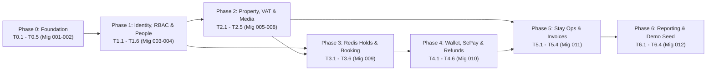

# Backend Task Breakdown — Hệ thống Quản lý Khách sạn (Đồ án môn học)

Bộ tài liệu này phân rã toàn bộ phần **Backend** của dự án quản lý khách sạn (single-hotel, Go modular monolith) thành **36 task dọc theo nghiệp vụ** trải dài qua **7 phase**, thiết kế tối ưu cho quy trình **1 lập trình viên + AI agent** triển khai tuần tự theo nguyên tắc:

> **1 Task = 1 Nghiệp vụ trọn vẹn (Migration/SQLC + Domain/Use case + HTTP Handler + OpenAPI + Test) = 1 Git Commit sạch.**

---

## 1. Nguồn chuẩn & Phạm vi đồ án

- **Tài liệu nguồn sự thật duy nhất:** [implementation-plan.md](../implementation-plan.md). Các tài liệu phân tích cũ hơn trong `BackEnd/docs/` (`database-design.md`, `api-specification.md`, `authentication-authorization.md`, `package-structure.md`, `testing-strategy.md`) chỉ mang tính tham khảo cho quy ước kỹ thuật không mâu thuẫn.
- **Bao gồm trọn vẹn 12 module cốt lõi:** Identity & Accounts, Dynamic RBAC (có Root bất biến), People (Khách hàng & Nhân viên), Property (Cấu hình khách sạn, Phòng, Loại phòng, Trạng thái vận hành, Danh mục dịch vụ), Media (MinIO), Booking & Holds (Redis Lua hold + PostgreSQL `btree_gist`), Pricing & VAT, Wallet & Payments (Sổ cái ví, Payment Intent, SePay dòng tiền vào, Hoàn tiền ví, Rút tiền minh họa), Stay Operations & Hóa đơn, Notification (SMTP Outbox), Reporting (Snapshot 19:00, Doanh thu ròng, Khách quay lại), Audit (Append-only).
- **Cắt bỏ theo phạm vi đồ án môn học (Out of Scope):**
  - Vận hành production nặng: backup `pg_dump`/WAL PITR & diễn tập restore hàng tháng, Prometheus/alerting, load/penetration testing, quét malware cho file upload MinIO, mã hóa envelope/KMS cho PII, tài liệu lưu trữ pháp lý dài hạn.
  - Không sửa code React trong `FrontEnd/` (chỉ dừng ở Backend REST API + OpenAPI 3.1 contract + seed demo).
  - Không làm module `Support` tickets (tồn tại ở tài liệu cũ nhưng không nằm trong 12 module của `implementation-plan.md`).
  - Không làm chuyển tiền ngân hàng ra ngoài (bank payout), thẻ thanh toán online, multi-tenancy, microservices, SMS, social login, đánh giá (reviews).

---

## 2. Quy tắc nghiệp vụ đã chốt (Bắt buộc tuân thủ khi code)

| Chủ đề | Quy tắc đã chốt |
|---|---|
| **Xác nhận Booking** | Booking online tự động `confirmed` khi **thanh toán đủ 100%** (Ví, SePay, hoặc Ví + SePay). Nhân viên có quyền `booking.confirm` có thể xác nhận thủ công cho khách đặt tại quầy (walk-in). Không có đặt cọc từng phần. |
| **Thanh toán Group Booking** | `payment_intents` hỗ trợ độc quyền `booking_id` **hoặc** `booking_group_id`. Khách đặt nhóm thanh toán **1 lần cho cả nhóm** (confirm tất cả phòng con trong 1 transaction và ghi `payment_allocations` cho từng phòng con để hỗ trợ hủy/hoàn lẻ chính xác). |
| **Walk-in & Hóa đơn Check-out** | Booking do nhân viên confirm được phép **check-in trước khi thanh toán**. Lúc check-out sinh hóa đơn bất biến gồm tiền phòng chưa trả + dịch vụ phát sinh (`paid` nếu còn thiếu = 0, ngược lại `issued`). Lễ tân thu phần còn thiếu qua `POST /api/v1/invoices/{id}/payments` (`cash` / `bank_transfer` / `wallet`). |
| **TTL giữ phòng (Redis Hold)** | Lưu trong `hotel_settings`: mặc định **15 phút** (đặt lẻ) và **30 phút** (đặt nhóm). **Admin tùy chỉnh được** qua `PUT /api/v1/hotel/settings` (chỉ áp dụng cho hold tạo mới). Trong group hold, **tất cả key phòng con kế thừa chung TTL nhóm**. Không có API gia hạn hold. |
| **Hủy & Hoàn tiền về ví** | Hủy khi `pending`: nhả hold + hủy intent đang chờ (nhả wallet hold), không hoàn tiền. Hủy khi `confirmed` trước check-in ≥ `free_cancel_hours` (mặc định **48h**): **tự động hoàn 100%** phần đã trả về ví. Hủy sát giờ (`< 48h`): không tự hoàn; nhân viên có quyền `payment.refund` có thể hoàn thủ công tối đa `settled - prior_refunds`. |
| **Wallet & SePay (Demo)** | **SePay**: chỉ nhận dòng tiền **vào** (`Authorization: Apikey`, khớp chính xác số tiền, dedupe theo `provider_tx_id`, chuyển trễ cộng ví 1 lần + có script giả lập local). **Nạp ví thủ công**: `POST /api/v1/wallet/deposits` cho Admin/Kế toán. **Rút tiền ví**: `POST /api/v1/wallet/withdrawals` làm **minh họa** — khóa ví (`FOR UPDATE`), kiểm tra không âm, trừ `available_balance` + ghi ledger `withdrawal_demo` là xong, **không chuyển tiền ngân hàng ra ngoài**. |
| **Giá & VAT** | Giá niêm yết (`room_types`, `service_catalog`) là **chưa gồm VAT** (`total = subtotal + subtotal * vat_rate`). **Bỏ phí dịch vụ (service fee)** riêng. Admin quản lý `vat_rates` (1 mức active tại 1 thời điểm, chụp snapshot lúc báo giá/booking/hóa đơn, chỉ deactivate không xóa cứng). |
| **Báo cáo Thực tế** | **Công suất**: chụp snapshot 19:00 giờ địa phương + backfill ngày lỡ, loại phòng `maintenance` khỏi mẫu số, chỉ đếm phòng đã `checked_in`. **Doanh thu**: `(payment_allocations + invoice_payments) - refunds`. **Khách quay lại**: Paid-gate tính cả thanh toán tại quầy, loại đơn hủy/hoàn 100%, **1 `booking_group` = 1 lần đặt**, tính kỳ theo `bookings.created_at`. |
| **SMTP & MinIO local** | Local dev chạy Docker Compose: PostgreSQL 16 + Redis 7 + MinIO + **Mailpit** (xem email kích hoạt/reset trực tiếp trên UI, vẫn hỗ trợ đổi sang Gmail SMTP qua `.env`). |

---

## 3. Danh mục mã quyền chuẩn (Permission Registry)

Sử dụng thống nhất trên toàn bộ Phase 1–6 (được seed sẵn ở `T1.1`, kiểm tra tại middleware + use case nhạy cảm; role `system-administrator` có `is_root = true` tự động vượt qua mọi quyền kể cả quyền thêm mới):

- **RBAC & Users:** `user.read`, `user.manage`, `role.read`, `role.create`, `role.update`, `role.delete`, `role.update_system`, `permission.read`, `permission.manage`, `role_permission.assign`, `user_role.assign`
- **People:** `employee.read`, `employee.create`, `employee.update`, `employee.deactivate`, `customer.read`, `customer.create`, `customer.update`, `customer.archive`
- **Property, VAT, Services & Media:** `hotel_settings.read`, `hotel_settings.update`, `vat.manage`, `property.read`, `room_type.manage`, `room.create`, `room.update`, `room.archive`, `room.state.update`, `service.read`, `service.manage`, `media.manage`
- **Bookings & Holds:** `booking.read`, `booking.create`, `booking.confirm`, `booking.cancel`
- **Wallet & Payments:** `wallet.read`, `wallet.deposit`, `payment.read`, `payment.record`, `payment.reconcile`, `payment.refund`
- **Stay Operations & Invoices:** `stay.check_in`, `stay.check_out`, `stay.service.manage`, `invoice.read`
- **Reporting & Audit:** `report.read`, `report.export`, `audit.read`
- **Khách hàng tự phục vụ (Customer Self-Service):** Kiểm tra `principal.Kind == "customer"` + quyền sở hữu tài nguyên (`/me`, holds, bookings, booking-groups, payment-intents, wallet, withdrawals, invoices của chính mình).

---

## 4. Quy ước kỹ thuật & Git Commit

- **Kiến trúc ranh giới module:** `delivery/http -> application -> domain -> repository port -> persistence/postgres`. Module A chỉ gọi Module B thông qua exported interface ở tầng `application`, không bao giờ import `persistence` hay mutate trực tiếp bảng của module khác.
- **Thứ tự code trong mỗi task:** Migration SQL (nếu có) → SQLC queries (`make sqlc`) → Domain & Application Use Case → HTTP Handler & cập nhật `BackEnd/api/openapi.yaml` → Unit/Integration Tests.
- **Quality Gate bắt buộc trước khi commit:**
  1. `cd BackEnd && go test -race ./...` xanh toàn bộ (không có race, `arch_test.go` pass).
  2. Migration mới chạy `up` sạch trên PostgreSQL trống; `sqlc generate` không tạo diff thừa.
  3. Commit theo chuẩn Conventional Commits (`feat(...)`, `chore(...)`) đúng 1 commit cho 1 task, rồi đánh dấu `[x]` ở bảng tiến độ dưới đây.

---

## 5. Sơ đồ phụ thuộc giữa các Phase

---

## 6. Bảng tiến độ tổng (Master Checklist — 36 Tasks)

### Phase 0 — Nền tảng kỹ thuật ([phase-0-foundation.md](phase-0-foundation.md))

| Trạng thái | Task | Nghiệp vụ | Phụ thuộc | Migration | Commit gợi ý |
| :---: | :---: | --- | --- | :---: | --- |
| [x] | **T0.1** | Khởi tạo Go module, cấu trúc thư mục & Docker Compose local | — | — | `chore(foundation): initialize go module, package layout and local docker stack` |
| [x] | **T0.2** | Typed env config, `slog` logging, `/healthz`, `/readyz` & graceful shutdown | `T0.1` | — | `feat(platform): add typed config, slog logger, health probes and graceful shutdown` |
| [x] | **T0.3** | `chi` router, error envelope, base middleware, OpenAPI 3.1 khung & boundary lint | `T0.2` | — | `feat(http): add chi router, error envelope, base middlewares, openapi skeleton and boundary lint` |
| [ ] | **T0.4** | `pgxpool`, shared PostgreSQL `TxRunner`, Testcontainers helper & Extensions | `T0.2` | `000001` | `feat(db): add pgxpool, shared transaction runner and base extensions migration` |
| [ ] | **T0.5** | Audit append-only & Transactional Outbox primitives + worker skeleton | `T0.3`, `T0.4` | `000002` | `feat(audit): add append-only audit events, transactional outbox and worker skeleton` |

### Phase 1 — Danh tính, Dynamic RBAC & Hồ sơ ([phase-1-identity-rbac.md](phase-1-identity-rbac.md))

| Trạng thái | Task | Nghiệp vụ | Phụ thuộc | Migration | Commit gợi ý |
| :---: | :---: | --- | --- | :---: | --- |
| [ ] | **T1.1** | Schema Identity & RBAC, seed danh mục quyền chuẩn & CLI bootstrap Root Admin | `T0.4`, `T0.5` | `000003` | `feat(identity): add identity and rbac schema, permission seed and root admin bootstrap cli` |
| [ ] | **T1.2** | Đăng ký khách hàng, đăng nhập Argon2id, JWT access & refresh cookie xoay vòng | `T1.1`, `T0.3` | — | `feat(identity): implement customer registration, argon2id login and rotating session tokens` |
| [ ] | **T1.3** | Quên mật khẩu & Adapter gửi email SMTP qua Outbox (Mailpit / Gmail) | `T1.2`, `T0.5` | — | `feat(notification): add smtp outbox delivery and password reset flow` |
| [ ] | **T1.4** | Dynamic RBAC middleware, Root bypass bất biến & API quản trị Role/Permission/User-Role | `T1.2` | — | `feat(rbac): implement dynamic authorization middleware, root bypass and rbac management apis` |
| [ ] | **T1.5** | Schema People, CRUD nhân viên & Luồng kích hoạt nhân viên qua Email SMTP | `T1.3`, `T1.4` | `000004` | `feat(people): add employee crud and atomic smtp email activation workflow` |
| [ ] | **T1.6** | Quản lý hồ sơ khách hàng (Staff CRUD) & Tự quản lý tài khoản `/me` | `T1.5` | — | `feat(people): add customer profile management and self-service me endpoints` |

### Phase 2 — Khách sạn, VAT, Phòng, Dịch vụ & MinIO Media ([phase-2-property-vat-media.md](phase-2-property-vat-media.md))

| Trạng thái | Task | Nghiệp vụ | Phụ thuộc | Migration | Commit gợi ý |
| :---: | :---: | --- | --- | :---: | --- |
| [ ] | **T2.1** | Cấu hình khách sạn (TTL giữ phòng tùy chỉnh), VAT CRUD & Pricing Quote Helper | `T1.4`, `T0.5` | `000005` | `feat(pricing): add hotel settings with configurable hold ttl, vat rates crud and quote calculator` |
| [ ] | **T2.2** | Loại phòng, Phòng vật lý, Staff CRUD (optimistic lock) & Catalogue công khai | `T2.1` | `000006` | `feat(property): add room types, physical rooms crud and public catalog search` |
| [ ] | **T2.3** | Chuyển trạng thái vận hành phòng (`available`/`cleaning`/`maintenance`) & lịch sử | `T2.2` | — | `feat(property): add controlled room operational state and maintenance transitions` |
| [ ] | **T2.4** | Danh mục dịch vụ khách sạn (CRUD & bảo vệ deactivate) | `T2.1` | `000007` | `feat(property): add service catalog crud and deactivation protection` |
| [ ] | **T2.5** | Module Media MinIO (presigned PUT, magic-byte check, gắn ảnh phòng & cleanup worker) | `T2.2`, `T0.5` | `000008` | `feat(media): add minio presigned upload, magic-byte validation, room linking and cleanup worker` |

### Phase 3 — Giữ phòng Redis & Đặt phòng Lẻ / Nhóm / Hủy ([phase-3-booking-holds.md](phase-3-booking-holds.md))

| Trạng thái | Task | Nghiệp vụ | Phụ thuộc | Migration | Commit gợi ý |
| :---: | :---: | --- | --- | :---: | --- |
| [ ] | **T3.1** | Schema Booking, Group, Guest Snapshot, Holds (`btree_gist`) & Quote/Availability | `T2.1`, `T2.2`, `T1.6` | `000009` | `feat(booking): add booking, holds, guest snapshot schema with gist exclusion and quote engine` |
| [ ] | **T3.2** | Giữ phòng nguyên tử bằng Redis Lua Script (lẻ/nhóm, TTL động, fail-closed 503) | `T3.1` | — | `feat(booking): add atomic redis lua room and group hold acquisition and release` |
| [ ] | **T3.3** | Worker quét hết hạn Hold trên PostgreSQL & Reconciler đồng bộ 2 chiều Redis | `T3.2`, `T0.5` | — | `feat(booking): add authoritative db hold expiry scanner and redis reconciler worker` |
| [ ] | **T3.4** | Đặt phòng lẻ từ Hold, Snapshot khách lưu trú, Idempotency & Staff Confirm | `T3.2`, `T3.3` | — | `feat(booking): implement individual booking creation from hold, guest snapshot and staff confirmation` |
| [ ] | **T3.5** | Đặt phòng theo nhóm (Group Booking Aggregate) & Tự động tính trạng thái nhóm | `T3.4` | — | `feat(booking): implement group booking aggregate creation and derived group status` |
| [ ] | **T3.6** | Hủy booking lẻ & Hủy hàng loạt All-or-Nothing (`POST /api/v1/bookings/batch/cancel`) | `T3.5` | — | `feat(booking): implement single booking cancel and all-or-nothing batch cancellation` |

### Phase 4 — Ví khách hàng, Payment Intent, SePay & Hoàn tiền ([phase-4-wallet-payments.md](phase-4-wallet-payments.md))

| Trạng thái | Task | Nghiệp vụ | Phụ thuộc | Migration | Commit gợi ý |
| :---: | :---: | --- | --- | :---: | --- |
| [ ] | **T4.1** | Schema Wallet & Payments (lẻ/nhóm, per-child allocation) & API đọc ví/sổ cái | `T3.5`, `T1.6` | `000010` | `feat(wallet): add wallet and payment schema with balance and ledger read apis` |
| [ ] | **T4.2** | Nạp ví thủ công Admin (`deposits`) & Rút tiền ví minh họa (`withdrawals`) | `T4.1` | — | `feat(wallet): add manual admin deposit and simulated customer withdrawal apis` |
| [ ] | **T4.3** | Payment Intent (Lẻ/Nhóm: Ví, SePay, Tách) + Hủy & Job hết hạn nhả Wallet Hold | `T4.2`, `T3.5` | — | `feat(payment): implement individual and group payment intents with wallet hold and expiry worker` |
| [ ] | **T4.4** | Webhook SePay dòng tiền vào (xác thực, dedupe, khớp tiền, chuyển trễ cộng ví) + Simulator | `T4.3`, `T0.5` | — | `feat(payment): implement sepay incoming webhook settlement, late transfer credit and local simulator` |
| [ ] | **T4.5** | Danh sách & đối soát thủ công biên lai ngân hàng `unmatched` cho nhân viên | `T4.4` | — | `feat(payment): add staff unmatched bank receipt review and manual reconciliation apis` |
| [ ] | **T4.6** | Hoàn tiền về ví (`POST /api/v1/refunds`) & Nối tự động hoàn tiền khi hủy miễn phí | `T4.4`, `T3.6` | — | `feat(payment): add wallet refund api and automatic free-cancellation refund hook` |

### Phase 5 — Vận hành lưu trú & Hóa đơn Check-out ([phase-5-stay-operations.md](phase-5-stay-operations.md))

| Trạng thái | Task | Nghiệp vụ | Phụ thuộc | Migration | Commit gợi ý |
| :---: | :---: | --- | --- | :---: | --- |
| [ ] | **T5.1** | Schema Stays & Billing + Quy trình Check-in (hỗ trợ cả walk-in chưa trả trước) | `T4.4`, `T2.3`, `T2.4` | `000011` | `feat(stayops): add stays and billing schema with check-in workflow` |
| [ ] | **T5.2** | Ghi nhận dịch vụ phát sinh trong lưu trú với snapshot giá/VAT bất biến | `T5.1`, `T2.4` | — | `feat(stayops): add stay service consumption recording with immutable price and vat snapshots` |
| [ ] | **T5.3** | Quy trình Check-out nguyên tử & Sinh hóa đơn bất biến + chuyển phòng `cleaning` | `T5.2`, `T4.4` | — | `feat(stayops): implement atomic check-out workflow with immutable invoice generation` |
| [ ] | **T5.4** | Thanh toán hóa đơn tại quầy (`cash`/`bank_transfer`/`wallet`), đọc hóa đơn & phòng sẵn sàng | `T5.3`, `T4.2` | — | `feat(stayops): add counter invoice payment settlement, invoice read apis and room-ready transition` |

### Phase 6 — Báo cáo thực tế, Snapshot 19:00 & Demo ([phase-6-reporting-demo.md](phase-6-reporting-demo.md))

| Trạng thái | Task | Nghiệp vụ | Phụ thuộc | Migration | Commit gợi ý |
| :---: | :---: | --- | --- | :---: | --- |
| [ ] | **T6.1** | Snapshot công suất phòng 19:00 hàng ngày, tự động backfill & API báo cáo công suất | `T5.3`, `T2.3` | `000012` | `feat(reporting): add 19:00 daily occupancy snapshot scheduler, backfill and occupancy report api` |
| [ ] | **T6.2** | Báo cáo doanh thu thực thu ròng (online + quầy − hoàn tiền) & Xuất CSV | `T5.4`, `T4.6` | — | `feat(reporting): add net revenue report api and bounded csv export` |
| [ ] | **T6.3** | Báo cáo khách hàng quay lại (paid-gate, 1 group = 1 lần đặt, 7 ngày/tháng/quý/năm) | `T5.4`, `T4.6` | — | `feat(reporting): add returning customers cohort report api` |
| [ ] | **T6.4** | API tra cứu Audit Log, CLI Seed dữ liệu Demo idempotent & Kịch bản Smoke Test E2E | `T6.1`, `T6.2`, `T6.3` | — | `feat(demo): add audit query api, idempotent demo seed cli and e2e verification guide` |

---

## 7. Hướng dẫn triển khai từng Task với AI Agent

Mỗi phiên làm việc, chỉ cần thực hiện đúng 4 bước gọn gàng sau:

1. **Chọn 1 task kế tiếp** chưa đánh dấu `[x]` có đủ `Phụ thuộc` đã xong.
2. **Giao ngữ cảnh tối thiểu cho AI Agent:** Trỏ AI đọc `BackEnd/docs/tasks/README.md` (mục 2–4) + đúng 1 file `BackEnd/docs/tasks/phase-N-*.md` tương ứng và yêu cầu *"Thực hiện đúng task `TN.M` theo tiêu chí nghiệm thu"*.
3. **Kiểm chứng:** Chạy `cd BackEnd && go test -race ./...` (và migration/SQLC nếu task có đổi DB) bảo đảm mọi test bắt buộc trong mục *Tiêu chí nghiệm thu* đều xanh.
4. **Commit & Cập nhật tiến độ:** Tạo đúng 1 git commit theo *Commit gợi ý* của task, đồng thời tick `[x]` trong bảng mục 6 của file này.
